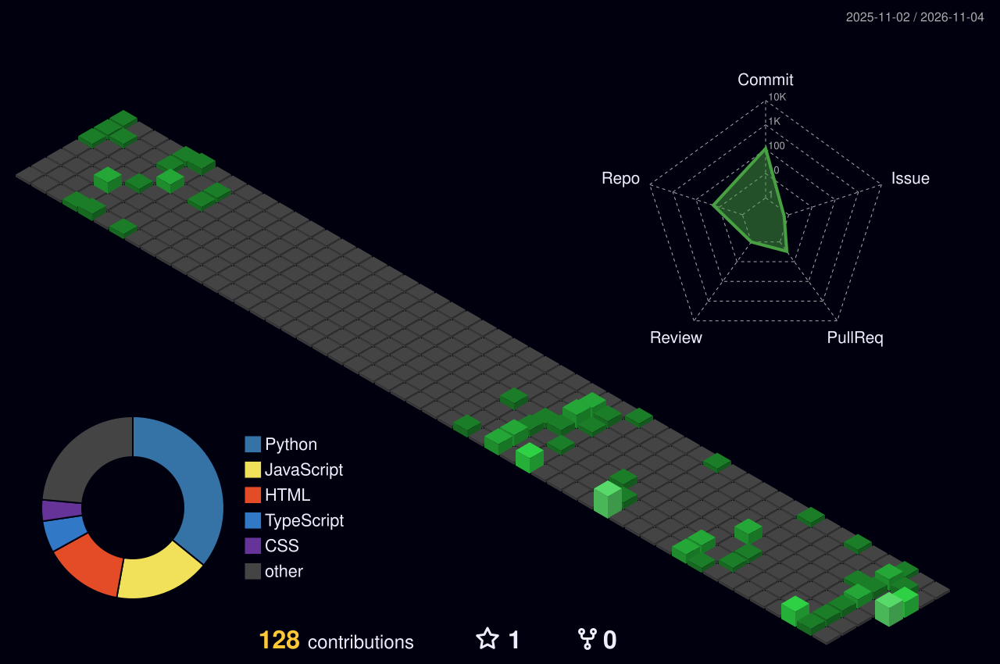

 
<!-- BANNER -->
<p align="center">
  
</p>

<!-- ANIMATED INTRO -->
<p align="center">
  <a href="https://git.io/typing-svg">
    
  </a>
</p>

<!-- TERMINAL INTRO -->
```diff
+ ┌──(ria㉿kali)-[~]
+ └─$ whoami
+
+ Riya Jamsutkar
+ Computer Engineering Student
+ Cybersecurity Enthusiast | Developer
```

### `$ cat about.txt`

```bash
┌──(riya㉿kali)-[~]
└─$ cat about.txt

Hey! I'm Riya, a Computer Engineering student passionate about
understanding how systems work, finding vulnerabilities, and
building secure applications.

I enjoy exploring cybersecurity, experimenting with new technologies
and learning through hands-on projects.
```


### `$ cat interests.txt`

```bash
┌──(riya㉿kali)-[~]
└─$ cat interests.txt

[+] Cybersecurity & Ethical Hacking
[+] Web Application Security & VAPT
[+] Network Security & Threat Detection
[+] Cloud Security & DevSecOps
[+] AI/ML for Security
```

---

### `$ ./skills.sh`

**PROGRAMMING LANGUAGES**

<p>

</p>

**CYBERSECURITY & NETWORKING**

<p>

</p>

`Wireshark` · `Nmap` · `Burp Suite` · `Kali Linux` · `Networking`

**WEB DEVELOPMENT & BACKEND**

<p>

</p>

**CLOUD & DEVOPS**

<p>

</p>

**DATA & AI**

`Python` · `Pandas` · `Scikit-learn` · `Random Forest` · `Isolation Forest`

---

### `$ ls ~/projects/`

<table>
<tr>
<td width="50%">

**01. AEGIS**

AI-powered cloud security and threat intelligence platform.

`Cloud Security` `AI/ML` `Python`

</td>
<td width="50%">

**02. AGENT RAKSHA**

Security monitoring and threat detection project.

`Cybersecurity` `Monitoring`

</td>
</tr>
<tr>
<td width="50%">

**03. CHAINGUARD**

ML-based DeFi transaction anomaly detection.

`FastAPI` `React` `Solidity` `ML`

</td>
<td width="50%">

**04. NETWORK IDS**

Secure segmented enterprise network with real-time intrusion detection.

`Networking` `Wireshark` `Python`

</td>
</tr>
<tr>
<td width="50%">

**05. DOCKERIZED API**

Containerized backend API development project.

`Docker` `Python` `API`

</td>
<td width="50%">

**06. DEVOPS PIPELINE**

CI/CD pipeline for an e-commerce microservice.

`Docker` `DevOps` `CI/CD`

</td>
</tr>
</table>

---

```bash
┌──(riya㉿kali)-[~]
└─$ cat currently_learning.txt

[+] Web Application Security
[+] Penetration Testing & VAPT
[+] Linux & Network Security
[+] Cloud Security
[+] DevSecOps
[+] Threat Intelligence
```

---

### `$ neofetch`

```bash
       .--.          riya@RJ42-CODER
      |o_o |         -------------------------
      |:_/ |         OS: Kali / Parrot-inspired
     //   \ \        HOST: GitHub
    (|     | )       ROLE: Computer Engineering
   /'\_   _/`\       FOCUS: Cybersecurity
   \___)=(___/       STATUS: Learning & Building
```

---

<h2 align="center">⌁ CONTRIBUTION MATRIX</h2>

<p align="center">
  
</p>

---

### `$ ./connect.sh`

<p align="center">
  <a href="https://github.com/RJ42-CODER">
    
  </a>
  <a href="https://www.linkedin.com/in/riya-jamsutkar/">
    
  </a>
  <a href="https://rjam.hashnode.dev/">
    
  </a>
</p>

<p align="center">
  <a href="https://rj42-coder.github.io/">
    
  </a>
</p>

---

<p align="center">
  
</p>

<p align="center">
  <code>[ SESSION STATUS: ACTIVE ]</code>
</p>

<p align="center">
  <sub>Designed with curiosity and a little terminal obsession.</sub>
</p>
